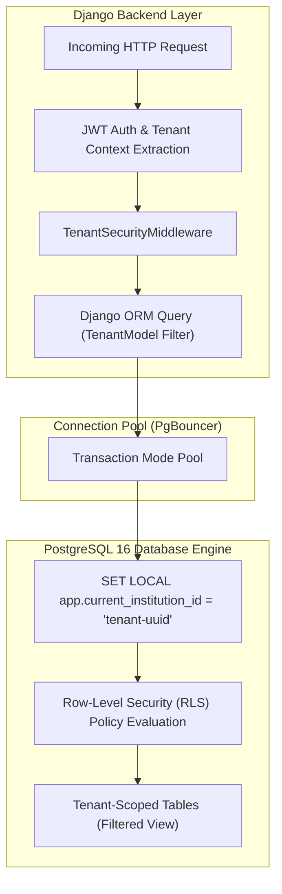
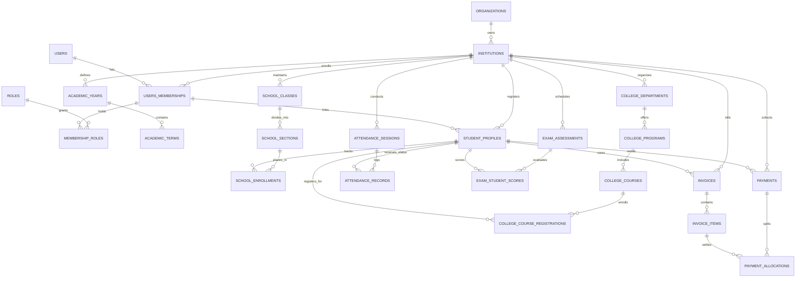

# EduNexus — Database Management System Architecture & Planning
## Comprehensive Database Specification, Relational Schema, and PostgreSQL Guide (`dbmsplanning.md`)

---

## 1. Database Architecture & Multi-Tenancy Strategy

### 1.1 Architectural Overview
EduNexus operates as a centralized multi-tenant Educational Resource Planning (ERP) platform. The persistent data layer is built on **PostgreSQL 16**, chosen for its transactional reliability (ACID compliance), rich constraint subsystem, native Row-Level Security (RLS), performant indexing engines (B-Tree, GIN, BRIN), and deep compatibility with the Django ORM via the modern `psycopg` (v3) driver.



### 1.2 Tenancy Model Comparison & Selection Rationale
Multi-tenancy in relational databases typically follows one of three architectures:

| Architectural Pattern | How It Works | Advantages | Disadvantages | Suitability for EduNexus |
| :--- | :--- | :--- | :--- | :--- |
| **Database-per-Tenant** | Each institution has its own physical PostgreSQL database instance or catalog. | Complete physical isolation; easy per-tenant backup restore. | Extreme operational cost; heavy connection exhaustion; schema migrations must run across hundreds of separate databases. | Not recommended for high-volume SaaS with small to mid-sized schools. |
| **Schema-per-Tenant** | One database with separate PostgreSQL schemas (`CREATE SCHEMA tenant_123`) per institution. | Logical isolation; shared database connection pool. | PostgreSQL catalog bloat degrades performance above 1,000 schemas; migrations frequently fail midway through iterations; cross-tenant reporting (trusts/groups) requires complex schema unions. | Fragile and unmaintainable at scale. |
| **Shared Database + Shared Schema (Selected)** | All tenants share the same tables. Every table includes an `institution_id` foreign key. Row-Level Security (RLS) enforces kernel-level isolation. | Minimal infrastructure footprint; single fast migration run across the entire platform; seamless cross-tenant reporting for educational trusts; optimal connection pooling via PgBouncer. | Requires strict discipline in software design to prevent accidental data leakage if an ORM filter is omitted. | **Optimal Choice** when fortified with PostgreSQL Row-Level Security (RLS). |

### 1.3 Dual-Gate Tenant Isolation Defense-in-Depth
EduNexus prevents cross-tenant data leakage by enforcing two independent validation gates:

1. **Gate 1 — Application Layer (Django ORM)**:
   - Every tenant entity inherits from `TenantModel`.
   - A custom `TenantManager` and `TenantQuerySet` automatically inject `.filter(institution=current_institution)` into every read, update, and delete query.
2. **Gate 2 — Database Kernel Layer (PostgreSQL Row-Level Security)**:
   - PostgreSQL RLS policies are enabled on all tenant-owned tables.
   - At the beginning of each database transaction, the Django middleware executes:
     ```sql
     SET LOCAL app.current_institution_id = 'c4b8e21a-6f3b-4871-9f30-8a2b5e91f120';
     ```
   - If an engineer writes a raw SQL query or forgets an ORM filter, PostgreSQL evaluates the table policy:
     ```sql
     CREATE POLICY institution_isolation_policy ON students
         FOR ALL
         USING (institution_id = NULLIF(current_setting('app.current_institution_id', true), '')::uuid);
     ```
     Rows belonging to other institutions are filtered out at the storage engine level before ever leaving PostgreSQL memory.

### 1.4 Transaction Isolation & Concurrency Control
- **Default Isolation Level**: `READ COMMITTED`. This satisfies 95% of standard read and write workloads, providing high concurrency without dirty reads.
- **Pessimistic Row Locking (`SELECT ... FOR UPDATE`)**: Used for critical race-condition-sensitive workflows where two transactions cannot proceed concurrently:
  - College course registration seat availability (preventing class over-subscription).
  - Fee invoice payments and multi-line item allocations (preventing over-allocation).
  - Annual school batch promotion roll calls.
- **Transaction Boundaries**: Wrapped using Django's `transaction.atomic()`. If any step in a multi-table workflow fails (such as an invalid grade calculation or payment discrepancy), PostgreSQL automatically issues a `ROLLBACK` to restore complete consistency.

---

## 2. Entity-Relationship Diagram (ERD) & Conceptual Data Flow



### Data Flow Overview
1. **Identity & Scope Flow**: An `Organization` owns multiple `Institutions`. A global `User` joins an institution through an `InstitutionMembership`, receiving scoped `Roles` and atomic `Permissions`.
2. **Academic Structural Flow**:
   - For **Schools**: `AcademicYear` $\rightarrow$ `SchoolClass` (Grade) $\rightarrow$ `SchoolSection` $\rightarrow$ `SchoolEnrollment` (cohort-based).
   - For **Colleges**: `AcademicYear` $\rightarrow$ `CollegeDepartment` $\rightarrow$ `CollegeProgram` $\rightarrow$ `CollegeCourse` $\rightarrow$ `CollegeCourseRegistration` (credit-based).
3. **Operational Activity Flow**: `StudentProfile` links to daily/lecture `AttendanceRecord`s, examination `ExamStudentScore`s, and financial `Invoice`s.
4. **Financial Settlement Flow**: `Invoice` contains multiple `InvoiceItem`s. A `Payment` is received from a student and split across items via `PaymentAllocation` records.

---

## 3. Table-by-Table Data Dictionary & Relational Schema

### 3.1 Tenancy, Identity & Role-Based Access Control (RBAC)

#### Table: `organizations`
- **Responsibility**: Represents the top-level legal entity (e.g., an educational trust, diocese, or university conglomerate).
- **Columns**:
  - `id` (`UUID`, PK, Default: `gen_random_uuid()`): Unique identifier.
  - `name` (`VARCHAR(255)`, NOT NULL): Official organization name.
  - `slug` (`VARCHAR(100)`, UNIQUE, NOT NULL): URL-safe subdomain identifier.
  - `billing_email` (`VARCHAR(255)`, NOT NULL): Billing and administrative contact.
  - `created_at` (`TIMESTAMPTZ`, NOT NULL, Default: `CLOCK_TIMESTAMP()`): Audit timestamp.
  - `updated_at` (`TIMESTAMPTZ`, NOT NULL, Default: `CLOCK_TIMESTAMP()`): Audit timestamp.
- **Constraints**: `UNIQUE(slug)`
- **Relationships**: 1:N with `institutions`.

#### Table: `institutions`
- **Responsibility**: The primary multi-tenant boundary. Represents an individual school, college, or institute.
- **Columns**:
  - `id` (`UUID`, PK, Default: `gen_random_uuid()`): Unique tenant identifier.
  - `organization_id` (`UUID`, FK -> `organizations.id` ON DELETE RESTRICT, NOT NULL): Parent organization.
  - `name` (`VARCHAR(255)`, NOT NULL): Display name of the institution.
  - `code` (`VARCHAR(50)`, NOT NULL): Short code (e.g., `'DPS-DEL'`, `'MIT-BLR'`).
  - `institution_type` (`VARCHAR(20)`, NOT NULL): Enum check: `'SCHOOL'`, `'COLLEGE'`, `'HYBRID'`.
  - `timezone` (`VARCHAR(50)`, NOT NULL, Default: `'UTC'`): IANA timezone string (e.g., `'Asia/Kolkata'`).
  - `currency_code` (`VARCHAR(3)`, NOT NULL, Default: `'USD'`): ISO-4217 currency code.
  - `is_active` (`BOOLEAN`, NOT NULL, Default: `TRUE`): Operational status.
  - `settings` (`JSONB`, NOT NULL, Default: `'{}'::jsonb`): Configurable feature flags, branding URLs.
  - `created_at` (`TIMESTAMPTZ`, NOT NULL, Default: `CLOCK_TIMESTAMP()`)
  - `updated_at` (`TIMESTAMPTZ`, NOT NULL, Default: `CLOCK_TIMESTAMP()`)
- **Constraints**:
  - `CHECK (institution_type IN ('SCHOOL', 'COLLEGE', 'HYBRID'))`
  - `UNIQUE (organization_id, code)`
- **Foreign Key Rationale**: `ON DELETE RESTRICT` prevents an organization from being accidentally deleted if active institutions exist under it.

#### Table: `users`
- **Responsibility**: Global authentication table. Represents a physical human identity.
- **Columns**:
  - `id` (`UUID`, PK, Default: `gen_random_uuid()`): Global user identifier.
  - `email` (`VARCHAR(255)`, UNIQUE, NOT NULL): Lowercase email used for login.
  - `phone_number` (`VARCHAR(20)`, UNIQUE, NULL): E.164 phone number.
  - `password_hash` (`VARCHAR(255)`, NOT NULL): Argon2id password hash.
  - `first_name` (`VARCHAR(100)`, NOT NULL): First name.
  - `last_name` (`VARCHAR(100)`, NOT NULL): Last name.
  - `is_platform_admin` (`BOOLEAN`, NOT NULL, Default: `FALSE`): Super-admin flag.
  - `is_active` (`BOOLEAN`, NOT NULL, Default: `TRUE`): Global account lock.
  - `created_at` (`TIMESTAMPTZ`, NOT NULL, Default: `CLOCK_TIMESTAMP()`)
  - `updated_at` (`TIMESTAMPTZ`, NOT NULL, Default: `CLOCK_TIMESTAMP()`)
- **Constraints**: `UNIQUE(email)`, `UNIQUE(phone_number)`.

#### Table: `institution_memberships`
- **Responsibility**: Binds a global user to a specific institution tenant.
- **Columns**:
  - `id` (`UUID`, PK, Default: `gen_random_uuid()`): Membership ID.
  - `institution_id` (`UUID`, FK -> `institutions.id` ON DELETE RESTRICT, NOT NULL): Institution tenant.
  - `user_id` (`UUID`, FK -> `users.id` ON DELETE CASCADE, NOT NULL): Associated user.
  - `membership_type` (`VARCHAR(30)`, NOT NULL): Enum: `'STUDENT'`, `'FACULTY'`, `'STAFF'`, `'PARENT'`.
  - `identification_number` (`VARCHAR(100)`, NOT NULL): Employee ID or Master Admission ID.
  - `status` (`VARCHAR(30)`, NOT NULL, Default: `'ACTIVE'`): `'ACTIVE'`, `'SUSPENDED'`, `'ALUMNI'`.
  - `created_at` (`TIMESTAMPTZ`, NOT NULL, Default: `CLOCK_TIMESTAMP()`)
- **Constraints**:
  - `UNIQUE (institution_id, user_id)`: A user can hold only one membership per institution.
  - `UNIQUE (institution_id, identification_number)`: ID numbers must be unique within an institution.
  - `CHECK (membership_type IN ('STUDENT', 'FACULTY', 'STAFF', 'PARENT'))`

#### Table: `roles`
- **Responsibility**: Configurable roles (e.g., Principal, Department Head, Class Teacher, Accountant).
- **Columns**:
  - `id` (`UUID`, PK, Default: `gen_random_uuid()`): Role ID.
  - `institution_id` (`UUID`, FK -> `institutions.id` ON DELETE RESTRICT, NULL): NULL indicates system default role template; Non-NULL indicates institution-customized role.
  - `name` (`VARCHAR(100)`, NOT NULL): Display name.
  - `code` (`VARCHAR(50)`, NOT NULL): Machine code (e.g., `'EXAM_CONTROLLER'`).
  - `description` (`TEXT`, NULL)
- **Constraints**: `UNIQUE (institution_id, code)`

#### Table: `permissions`
- **Responsibility**: Granular atomic permissions.
- **Columns**:
  - `id` (`VARCHAR(100)`, PK): Slug identifier (e.g., `'academics:grades:publish'`).
  - `category` (`VARCHAR(50)`, NOT NULL): E.g., `'ACADEMICS'`, `'FINANCE'`, `'ATTENDANCE'`.
  - `description` (`TEXT`, NOT NULL)

#### Table: `role_permissions` (Junction Table)
- **Responsibility**: M:N mapping between roles and permissions.
- **Columns**:
  - `role_id` (`UUID`, FK -> `roles.id` ON DELETE CASCADE, NOT NULL)
  - `permission_id` (`VARCHAR(100)`, FK -> `permissions.id` ON DELETE CASCADE, NOT NULL)
- **Primary Key**: `PRIMARY KEY (role_id, permission_id)`

#### Table: `membership_roles` (Scoped Role Assignment)
- **Responsibility**: Assigns a role to a user membership, with optional structural scoping.
- **Columns**:
  - `id` (`UUID`, PK, Default: `gen_random_uuid()`)
  - `membership_id` (`UUID`, FK -> `institution_memberships.id` ON DELETE CASCADE, NOT NULL)
  - `role_id` (`UUID`, FK -> `roles.id` ON DELETE CASCADE, NOT NULL)
  - `scope_type` (`VARCHAR(50)`, NULL): Enum: `'GLOBAL'`, `'SCHOOL_CLASS'`, `'SCHOOL_SECTION'`, `'COLLEGE_DEPARTMENT'`.
  - `scope_id` (`UUID`, NULL): Target entity ID matching `scope_type`.
- **Constraints**: `UNIQUE (membership_id, role_id, scope_type, scope_id)`

---

### 3.2 Academic Core Entities (Shared, School & College)

#### Table: `academic_years`
- **Responsibility**: Defines academic calendar cycles (e.g., 2025-2026).
- **Columns**:
  - `id` (`UUID`, PK, Default: `gen_random_uuid()`)
  - `institution_id` (`UUID`, FK -> `institutions.id` ON DELETE RESTRICT, NOT NULL)
  - `name` (`VARCHAR(50)`, NOT NULL): E.g., `'2025-2026'`.
  - `start_date` (`DATE`, NOT NULL): Cycle start.
  - `end_date` (`DATE`, NOT NULL): Cycle end.
  - `is_current` (`BOOLEAN`, NOT NULL, Default: `FALSE`): Active year indicator.
- **Constraints**:
  - `CHECK (end_date > start_date)`
  - `UNIQUE (institution_id, name)`

#### Table: `academic_terms`
- **Responsibility**: Sub-divisions of an academic year (Semesters, Trimesters, Terms).
- **Columns**:
  - `id` (`UUID`, PK, Default: `gen_random_uuid()`)
  - `institution_id` (`UUID`, FK -> `institutions.id` ON DELETE RESTRICT, NOT NULL)
  - `academic_year_id` (`UUID`, FK -> `academic_years.id` ON DELETE CASCADE, NOT NULL)
  - `name` (`VARCHAR(100)`, NOT NULL): E.g., `'Fall Semester 2025'`, `'Term 1'`.
  - `start_date` (`DATE`, NOT NULL)
  - `end_date` (`DATE`, NOT NULL)
  - `is_active` (`BOOLEAN`, NOT NULL, Default: `FALSE`)
- **Constraints**:
  - `CHECK (end_date >= start_date)`
  - `UNIQUE (academic_year_id, name)`

#### Table: `school_classes` (School-Specific)
- **Responsibility**: Represents school grade levels (e.g., Grade 9, Grade 10).
- **Columns**:
  - `id` (`UUID`, PK, Default: `gen_random_uuid()`)
  - `institution_id` (`UUID`, FK -> `institutions.id` ON DELETE RESTRICT, NOT NULL)
  - `name` (`VARCHAR(50)`, NOT NULL): E.g., `'Grade 10'`.
  - `sequence_order` (`SMALLINT`, NOT NULL): Integer index (1 to 12) for progression order.
- **Constraints**: `UNIQUE (institution_id, sequence_order)`

#### Table: `school_sections` (School-Specific)
- **Responsibility**: Divisions or sections within a grade (e.g., Grade 10-A).
- **Columns**:
  - `id` (`UUID`, PK, Default: `gen_random_uuid()`)
  - `institution_id` (`UUID`, FK -> `institutions.id` ON DELETE RESTRICT, NOT NULL)
  - `school_class_id` (`UUID`, FK -> `school_classes.id` ON DELETE RESTRICT, NOT NULL)
  - `name` (`VARCHAR(20)`, NOT NULL): Section name (e.g., `'A'`, `'B'`).
  - `room_number` (`VARCHAR(50)`, NULL): Physical classroom identifier.
  - `class_teacher_id` (`UUID`, FK -> `institution_memberships.id` ON DELETE SET NULL, NULL)
- **Constraints**: `UNIQUE (school_class_id, name)`

#### Table: `college_departments` (College-Specific)
- **Responsibility**: Academic departments (e.g., Department of Mechanical Engineering).
- **Columns**:
  - `id` (`UUID`, PK, Default: `gen_random_uuid()`)
  - `institution_id` (`UUID`, FK -> `institutions.id` ON DELETE RESTRICT, NOT NULL)
  - `name` (`VARCHAR(150)`, NOT NULL): Department name.
  - `code` (`VARCHAR(20)`, NOT NULL): Machine code (e.g., `'CSE'`, `'MECH'`).
  - `head_of_department_id` (`UUID`, FK -> `institution_memberships.id` ON DELETE SET NULL, NULL)
- **Constraints**: `UNIQUE (institution_id, code)`

#### Table: `college_programs` (College-Specific)
- **Responsibility**: Degree programs offered by departments (e.g., B.Tech in CSE).
- **Columns**:
  - `id` (`UUID`, PK, Default: `gen_random_uuid()`)
  - `institution_id` (`UUID`, FK -> `institutions.id` ON DELETE RESTRICT, NOT NULL)
  - `department_id` (`UUID`, FK -> `college_departments.id` ON DELETE RESTRICT, NOT NULL)
  - `name` (`VARCHAR(150)`, NOT NULL): Program title.
  - `code` (`VARCHAR(30)`, NOT NULL): Degree code (e.g., `'BTECH-CSE'`).
  - `duration_semesters` (`SMALLINT`, NOT NULL): Standard duration (e.g., 8).
  - `total_credits_required` (`NUMERIC(5, 2)`, NOT NULL): Graduation credit bar (e.g., 160.00).
- **Constraints**: `UNIQUE (institution_id, code)`

#### Table: `college_courses` (College-Specific)
- **Responsibility**: Course catalog entries specifying credit breakdown (Lecture-Tutorial-Practical).
- **Columns**:
  - `id` (`UUID`, PK, Default: `gen_random_uuid()`)
  - `institution_id` (`UUID`, FK -> `institutions.id` ON DELETE RESTRICT, NOT NULL)
  - `department_id` (`UUID`, FK -> `college_departments.id` ON DELETE RESTRICT, NOT NULL)
  - `course_code` (`VARCHAR(30)`, NOT NULL): E.g., `'CS401'`.
  - `title` (`VARCHAR(200)`, NOT NULL): Course title.
  - `lecture_credits` (`SMALLINT`, NOT NULL, Default: 3): L credits.
  - `tutorial_credits` (`SMALLINT`, NOT NULL, Default: 0): T credits.
  - `practical_credits` (`SMALLINT`, NOT NULL, Default: 1): P credits.
  - `total_credits` (`NUMERIC(4, 2)`, NOT NULL): Total credit points (e.g., 4.00).
  - `is_elective` (`BOOLEAN`, NOT NULL, Default: `FALSE`)
- **Constraints**:
  - `UNIQUE (institution_id, course_code)`
  - `CHECK (total_credits > 0)`

---

### 3.3 Student Information System (SIS)

#### Table: `student_profiles`
- **Responsibility**: Persistent master student record. Decoupled from annual classroom enrollment.
- **Columns**:
  - `id` (`UUID`, PK, Default: `gen_random_uuid()`)
  - `institution_id` (`UUID`, FK -> `institutions.id` ON DELETE RESTRICT, NOT NULL)
  - `membership_id` (`UUID`, FK -> `institution_memberships.id` ON DELETE RESTRICT, UNIQUE, NOT NULL)
  - `admission_number` (`VARCHAR(100)`, NOT NULL): Unique admission/registration number.
  - `admission_date` (`DATE`, NOT NULL)
  - `date_of_birth` (`DATE`, NOT NULL)
  - `gender` (`VARCHAR(20)`, NOT NULL): `'MALE'`, `'FEMALE'`, `'NON_BINARY'`, `'OTHER'`.
  - `blood_group` (`VARCHAR(5)`, NULL): E.g., `'O+'`, `'A-'`.
  - `residential_address` (`TEXT`, NOT NULL)
  - `emergency_contact_name` (`VARCHAR(150)`, NOT NULL)
  - `emergency_contact_phone` (`VARCHAR(25)`, NOT NULL)
  - `current_status` (`VARCHAR(30)`, NOT NULL, Default: `'ACTIVE'`): `'ACTIVE'`, `'ON_LEAVE'`, `'TRANSFERRED'`, `'GRADUATED'`, `'SUSPENDED'`, `'EXPELLED'`.
- **Constraints**:
  - `UNIQUE (institution_id, admission_number)`
  - `CHECK (current_status IN ('ACTIVE', 'ON_LEAVE', 'TRANSFERRED', 'GRADUATED', 'SUSPENDED', 'EXPELLED'))`

#### Table: `school_enrollments` (School Cohort Enrollment)
- **Responsibility**: M:N junction recording which school section a student attends in a given academic year.
- **Columns**:
  - `id` (`UUID`, PK, Default: `gen_random_uuid()`)
  - `institution_id` (`UUID`, FK -> `institutions.id` ON DELETE RESTRICT, NOT NULL)
  - `student_id` (`UUID`, FK -> `student_profiles.id` ON DELETE RESTRICT, NOT NULL)
  - `academic_year_id` (`UUID`, FK -> `academic_years.id` ON DELETE RESTRICT, NOT NULL)
  - `section_id` (`UUID`, FK -> `school_sections.id` ON DELETE RESTRICT, NOT NULL)
  - `roll_number` (`SMALLINT`, NULL): Position in section roll call.
  - `enrollment_status` (`VARCHAR(30)`, NOT NULL, Default: `'ENROLLED'`): `'ENROLLED'`, `'PROMOTED'`, `'RETAINED'`, `'WITHDRAWN'`.
- **Constraints**:
  - `UNIQUE (academic_year_id, student_id)`: A student cannot be enrolled in two sections in the same academic year.
  - `UNIQUE (academic_year_id, section_id, roll_number)`: Roll numbers cannot be duplicated within a section.

#### Table: `college_course_registrations` (College Credit Enrollment)
- **Responsibility**: Individual course enrollment for college students per term.
- **Columns**:
  - `id` (`UUID`, PK, Default: `gen_random_uuid()`)
  - `institution_id` (`UUID`, FK -> `institutions.id` ON DELETE RESTRICT, NOT NULL)
  - `student_id` (`UUID`, FK -> `student_profiles.id` ON DELETE RESTRICT, NOT NULL)
  - `academic_term_id` (`UUID`, FK -> `academic_terms.id` ON DELETE RESTRICT, NOT NULL)
  - `course_id` (`UUID`, FK -> `college_courses.id` ON DELETE RESTRICT, NOT NULL)
  - `registration_type` (`VARCHAR(30)`, NOT NULL, Default: `'REGULAR'`): `'REGULAR'`, `'ELECTIVE'`, `'AUDIT'`, `'BACKLOG_REPEAT'`.
  - `registration_status` (`VARCHAR(30)`, NOT NULL, Default: `'REGISTERED'`): `'REGISTERED'`, `'DROPPED'`, `'WITHDRAWN'`.
- **Constraints**: `UNIQUE (academic_term_id, student_id, course_id)`

---

### 3.4 Attendance Management

#### Table: `attendance_sessions`
- **Responsibility**: A single roll call event (a full day for school, or a specific lecture hour for college).
- **Columns**:
  - `id` (`UUID`, PK, Default: `gen_random_uuid()`)
  - `institution_id` (`UUID`, FK -> `institutions.id` ON DELETE RESTRICT, NOT NULL)
  - `session_date` (`DATE`, NOT NULL)
  - `session_type` (`VARCHAR(20)`, NOT NULL): `'DAILY_HOMEROOM'`, `'PERIOD_WISE'`, `'LECTURE'`.
  - `school_section_id` (`UUID`, FK -> `school_sections.id` ON DELETE CASCADE, NULL)
  - `college_course_id` (`UUID`, FK -> `college_courses.id` ON DELETE CASCADE, NULL)
  - `period_slot` (`SMALLINT`, NULL): 1, 2, 3...
  - `taken_by_membership_id` (`UUID`, FK -> `institution_memberships.id` ON DELETE RESTRICT, NOT NULL)
  - `is_locked` (`BOOLEAN`, NOT NULL, Default: `FALSE`): Prevents post-hoc editing.
- **Constraints**:
  - `CHECK ((school_section_id IS NOT NULL AND college_course_id IS NULL) OR (school_section_id IS NULL AND college_course_id IS NOT NULL))`
  - `UNIQUE (institution_id, session_date, school_section_id, period_slot)`

#### Table: `attendance_records`
- **Responsibility**: Status of an individual student in a given attendance session.
- **Columns**:
  - `id` (`UUID`, PK, Default: `gen_random_uuid()`)
  - `institution_id` (`UUID`, FK -> `institutions.id` ON DELETE RESTRICT, NOT NULL)
  - `session_id` (`UUID`, FK -> `attendance_sessions.id` ON DELETE CASCADE, NOT NULL)
  - `student_id` (`UUID`, FK -> `student_profiles.id` ON DELETE RESTRICT, NOT NULL)
  - `status` (`VARCHAR(20)`, NOT NULL): `'PRESENT'`, `'ABSENT'`, `'LATE'`, `'EXCUSED'`.
  - `remarks` (`TEXT`, NULL)
- **Constraints**:
  - `UNIQUE (session_id, student_id)`
  - `CHECK (status IN ('PRESENT', 'ABSENT', 'LATE', 'EXCUSED'))`

#### Table: `attendance_audit_logs`
- **Responsibility**: Immutable record of post-lock corrections for attendance.
- **Columns**:
  - `id` (`UUID`, PK, Default: `gen_random_uuid()`)
  - `attendance_record_id` (`UUID`, FK -> `attendance_records.id` ON DELETE CASCADE, NOT NULL)
  - `previous_status` (`VARCHAR(20)`, NOT NULL)
  - `new_status` (`VARCHAR(20)`, NOT NULL)
  - `modified_by_id` (`UUID`, FK -> `institution_memberships.id` ON DELETE RESTRICT, NOT NULL)
  - `reason` (`TEXT`, NOT NULL)
  - `timestamp` (`TIMESTAMPTZ`, NOT NULL, Default: `CLOCK_TIMESTAMP()`)

---

### 3.5 Examination & Grading

#### Table: `exam_grading_scales`
- **Responsibility**: Defines grading frameworks (e.g., 10-Point CGPA scale, CBSE percentage scale).
- **Columns**:
  - `id` (`UUID`, PK, Default: `gen_random_uuid()`)
  - `institution_id` (`UUID`, FK -> `institutions.id` ON DELETE RESTRICT, NOT NULL)
  - `name` (`VARCHAR(100)`, NOT NULL)
  - `scale_type` (`VARCHAR(30)`, NOT NULL): `'PERCENTAGE_BASED'`, `'LETTER_GRADE_POINTS'`.

#### Table: `grading_scale_tiers`
- **Responsibility**: Individual bands/tiers within a grading scale.
- **Columns**:
  - `id` (`UUID`, PK, Default: `gen_random_uuid()`)
  - `grading_scale_id` (`UUID`, FK -> `exam_grading_scales.id` ON DELETE CASCADE, NOT NULL)
  - `letter_grade` (`VARCHAR(5)`, NOT NULL): E.g., `'O'`, `'A+'`, `'F'`.
  - `min_percentage` (`NUMERIC(5, 2)`, NOT NULL): E.g., 90.00.
  - `max_percentage` (`NUMERIC(5, 2)`, NOT NULL): E.g., 100.00.
  - `grade_point` (`NUMERIC(4, 2)`, NOT NULL): E.g., 10.00.
  - `is_passing_grade` (`BOOLEAN`, NOT NULL, Default: `TRUE`)
- **Constraints**: `CHECK (max_percentage >= min_percentage)`

#### Table: `exam_assessments`
- **Responsibility**: Represents an examination or assessment component.
- **Columns**:
  - `id` (`UUID`, PK, Default: `gen_random_uuid()`)
  - `institution_id` (`UUID`, FK -> `institutions.id` ON DELETE RESTRICT, NOT NULL)
  - `academic_term_id` (`UUID`, FK -> `academic_terms.id` ON DELETE RESTRICT, NOT NULL)
  - `name` (`VARCHAR(150)`, NOT NULL): E.g., `'Mid-Term Theory Exam'`.
  - `assessment_type` (`VARCHAR(30)`, NOT NULL): `'INTERNAL'`, `'THEORY_FINAL'`, `'PRACTICAL_LAB'`.
  - `max_marks` (`NUMERIC(6, 2)`, NOT NULL): Total marks possible.
  - `pass_marks` (`NUMERIC(6, 2)`, NOT NULL): Minimum passing threshold.
  - `weightage_percentage` (`NUMERIC(5, 2)`, NOT NULL, Default: 100.00)
  - `status` (`VARCHAR(30)`, NOT NULL, Default: `'DRAFT'`): `'DRAFT'`, `'MARKS_ENTRY_OPEN'`, `'MODERATION'`, `'PUBLISHED'`, `'LOCKED'`.
- **Constraints**:
  - `CHECK (pass_marks <= max_marks)`
  - `CHECK (max_marks > 0)`

#### Table: `exam_student_scores`
- **Responsibility**: Marks achieved by a student in an assessment.
- **Columns**:
  - `id` (`UUID`, PK, Default: `gen_random_uuid()`)
  - `institution_id` (`UUID`, FK -> `institutions.id` ON DELETE RESTRICT, NOT NULL)
  - `assessment_id` (`UUID`, FK -> `exam_assessments.id` ON DELETE RESTRICT, NOT NULL)
  - `student_id` (`UUID`, FK -> `student_profiles.id` ON DELETE RESTRICT, NOT NULL)
  - `marks_obtained` (`NUMERIC(6, 2)`, NULL): NULL if student was absent.
  - `is_absent` (`BOOLEAN`, NOT NULL, Default: `FALSE`)
  - `grade_point_awarded` (`NUMERIC(4, 2)`, NULL)
  - `letter_grade_awarded` (`VARCHAR(5)`, NULL)
  - `evaluator_membership_id` (`UUID`, FK -> `institution_memberships.id` ON DELETE RESTRICT, NOT NULL)
  - `evaluated_at` (`TIMESTAMPTZ`, NOT NULL, Default: `CLOCK_TIMESTAMP()`)
- **Constraints**:
  - `UNIQUE (assessment_id, student_id)`
  - `CHECK (marks_obtained >= 0)`
  - `CHECK (marks_obtained <= 1000.00)`

---

### 3.6 Fee & Financial Accounting

#### Table: `fee_structures`
- **Responsibility**: Master fee template defining standard billings for a class or program.
- **Columns**:
  - `id` (`UUID`, PK, Default: `gen_random_uuid()`)
  - `institution_id` (`UUID`, FK -> `institutions.id` ON DELETE RESTRICT, NOT NULL)
  - `academic_year_id` (`UUID`, FK -> `academic_years.id` ON DELETE RESTRICT, NOT NULL)
  - `name` (`VARCHAR(150)`, NOT NULL): E.g., `'Grade 10 Annual Fee'`.
  - `target_type` (`VARCHAR(30)`, NOT NULL): `'SCHOOL_CLASS'`, `'COLLEGE_PROGRAM'`.
  - `school_class_id` (`UUID`, FK -> `school_classes.id` ON DELETE RESTRICT, NULL)
  - `college_program_id` (`UUID`, FK -> `college_programs.id` ON DELETE RESTRICT, NULL)
  - `total_amount` (`BIGINT`, NOT NULL): Stored in minor currency units (cents/paise).
- **Constraints**: `CHECK (total_amount >= 0)`

#### Table: `invoices`
- **Responsibility**: Accounts receivable billed to an individual student.
- **Columns**:
  - `id` (`UUID`, PK, Default: `gen_random_uuid()`)
  - `institution_id` (`UUID`, FK -> `institutions.id` ON DELETE RESTRICT, NOT NULL)
  - `student_id` (`UUID`, FK -> `student_profiles.id` ON DELETE RESTRICT, NOT NULL)
  - `invoice_number` (`VARCHAR(50)`, NOT NULL): Human-readable formatted string (e.g., `'INV-2025-00123'`).
  - `issue_date` (`DATE`, NOT NULL)
  - `due_date` (`DATE`, NOT NULL)
  - `subtotal_amount` (`BIGINT`, NOT NULL): Minor currency units.
  - `discount_amount` (`BIGINT`, NOT NULL, Default: 0)
  - `tax_amount` (`BIGINT`, NOT NULL, Default: 0)
  - `total_amount` (`BIGINT`, NOT NULL): Calculated: `subtotal - discount + tax`.
  - `paid_amount` (`BIGINT`, NOT NULL, Default: 0): Controlled denormalized total.
  - `status` (`VARCHAR(30)`, NOT NULL, Default: `'UNPAID'`): `'DRAFT'`, `'UNPAID'`, `'PARTIALLY_PAID'`, `'PAID'`, `'OVERDUE'`, `'CANCELLED'`.
- **Constraints**:
  - `UNIQUE (institution_id, invoice_number)`
  - `CHECK (due_date >= issue_date)`
  - `CHECK (paid_amount <= total_amount)`
  - `CHECK (total_amount >= 0)`

#### Table: `invoice_items`
- **Responsibility**: Line-item breakdown of an invoice (Tuition, Lab, Transport).
- **Columns**:
  - `id` (`UUID`, PK, Default: `gen_random_uuid()`)
  - `invoice_id` (`UUID`, FK -> `invoices.id` ON DELETE CASCADE, NOT NULL)
  - `fee_category` (`VARCHAR(50)`, NOT NULL): E.g., `'TUITION'`, `'LAB'`.
  - `amount` (`BIGINT`, NOT NULL): Minor currency units.
  - `allocated_amount` (`BIGINT`, NOT NULL, Default: 0): Settled via payments.
- **Constraints**:
  - `CHECK (allocated_amount <= amount)`
  - `CHECK (amount >= 0)`

#### Table: `payments`
- **Responsibility**: Records financial remittances received from students/parents.
- **Columns**:
  - `id` (`UUID`, PK, Default: `gen_random_uuid()`)
  - `institution_id` (`UUID`, FK -> `institutions.id` ON DELETE RESTRICT, NOT NULL)
  - `student_id` (`UUID`, FK -> `student_profiles.id` ON DELETE RESTRICT, NOT NULL)
  - `receipt_number` (`VARCHAR(50)`, NOT NULL): Unique receipt string.
  - `payment_method` (`VARCHAR(30)`, NOT NULL): `'CASH'`, `'BANK_TRANSFER'`, `'CREDIT_CARD'`, `'ONLINE_GATEWAY'`.
  - `amount` (`BIGINT`, NOT NULL): Payment received.
  - `currency` (`VARCHAR(3)`, NOT NULL, Default: `'USD'`)
  - `idempotency_key` (`VARCHAR(255)`, UNIQUE, NOT NULL): Duplicate submission safeguard.
  - `gateway_transaction_id` (`VARCHAR(255)`, NULL): Gateway reference ID.
  - `status` (`VARCHAR(30)`, NOT NULL, Default: `'COMPLETED'`): `'INITIATED'`, `'COMPLETED'`, `'FAILED'`, `'REFUNDED'`.
  - `received_at` (`TIMESTAMPTZ`, NOT NULL, Default: `CLOCK_TIMESTAMP()`)
- **Constraints**:
  - `UNIQUE (institution_id, receipt_number)`
  - `CHECK (amount > 0)`

#### Table: `payment_allocations`
- **Responsibility**: Junction table splitting a payment across specific invoice line items.
- **Columns**:
  - `id` (`UUID`, PK, Default: `gen_random_uuid()`)
  - `payment_id` (`UUID`, FK -> `payments.id` ON DELETE RESTRICT, NOT NULL)
  - `invoice_item_id` (`UUID`, FK -> `invoice_items.id` ON DELETE RESTRICT, NOT NULL)
  - `allocated_amount` (`BIGINT`, NOT NULL): Portioned sum for this line item.
  - `created_at` (`TIMESTAMPTZ`, NOT NULL, Default: `CLOCK_TIMESTAMP()`)
- **Constraints**: `CHECK (allocated_amount > 0)`

---

## 4. Normalization & Integrity Analysis

### 4.1 Boyce-Codd Normal Form (BCNF) / 3NF Compliance
The relational schema satisfies Boyce-Codd Normal Form across transactional domains:
1. **First Normal Form (1NF)**: Every table has a primary key (`id` UUID). Columns store strictly atomic values. Repeating groups (such as multiple phone numbers or line items) are isolated into dedicated relational tables.
2. **Second Normal Form (2NF)**: All non-key attributes depend entirely on the primary key, eliminating partial dependencies.
3. **Third Normal Form (3NF)**: Transitive dependencies are eliminated. For instance, student biographical data (birth date, blood group) exists on `student_profiles`, while dynamic yearly status exists on `school_enrollments`. Graduating or transferring a student modifies enrollment without mutating historical profile records.
4. **Boyce-Codd Normal Form (BCNF)**: For every functional dependency $X \rightarrow Y$, $X$ is a superkey.

### 4.2 Deliberate Denormalization & Integrity Guardrails
Unrestricted normalization can cause excessive query joins that hurt high-traffic dashboard read performance. EduNexus implements controlled denormalization only where strictly necessary, reinforced by transaction locks:

1. **`invoices.paid_amount`**:
   - *Why*: Aggregating `payments` $\rightarrow$ `payment_allocations` $\rightarrow$ `invoice_items` on every student billing lookup produces an expensive 4-table join.
   - *Integrity Guardrail*: The `paid_amount` field is read-only for public APIs and can only be mutated inside an atomic transaction using:
     ```python
     Invoice.objects.filter(id=invoice_id).update(paid_amount=F('paid_amount') + allocated_chunk)
     ```
2. **`college_courses.total_credits`**:
   - *Why*: Calculated from `lecture_credits + tutorial_credits + practical_credits`.
   - *Integrity Guardrail*: Validated at both the Django model `clean()` method and via PostgreSQL check constraint:
     ```sql
     ALTER TABLE college_courses ADD CONSTRAINT check_total_credits_positive CHECK (total_credits > 0);
     ```

### 4.3 Monetary Storage Precision
- **Never Use Floating-Point Types**: IEEE 754 floating-point representations (`FLOAT`, `DOUBLE PRECISION`) cause binary rounding drift (e.g., `0.1 + 0.2 = 0.30000000000000004`), which is unacceptable for audit-grade financial ledgers.
- **Minor Currency Units (`BIGINT`)**: Monetary values are stored as integers representing cents/paise (e.g., \$150.75 is stored as `15075`).
- **Database Safeguard**: Check constraints guarantee that `amount >= 0` across all financial tables.

---

## 5. PostgreSQL Indexing Strategy

Indexing in PostgreSQL must reflect real query access patterns rather than adding indexes to every column blindly.

```mermaid
flowchart LR
    Query["Incoming SQL Query"] --> Match{"Index Match?"}
    Match -->|Composite Index (institution_id, col)| FastScan["Index Scan (Sub-millisecond)"]
    Match -->|No Matching Index| SeqScan["Sequential Scan (Table Bloat & Slow Latency)"]
```

### 5.1 Index Specifications & Justifications

| Table | Indexed Columns | Index Type | Business & Query Justification |
| :--- | :--- | :--- | :--- |
| `student_profiles` | `(institution_id, admission_number)` | Unique B-Tree | Quick lookup when scanning student ID cards or searching admission numbers. |
| `student_profiles` | `(institution_id, current_status)` | Partial B-Tree (`WHERE current_status = 'ACTIVE'`) | 95% of operational queries only care about currently active students. Partial indexing saves 70% index storage. |
| `school_enrollments` | `(academic_year_id, section_id)` | Composite B-Tree | Executed on every class attendance roll call and report card generation run. |
| `attendance_sessions`| `(institution_id, session_date, school_section_id)` | Composite B-Tree | Quickly identifies if today's attendance has already been recorded for a class. |
| `attendance_records` | `(session_id, status)` | Composite B-Tree | Optimizes real-time absentee counting when sending morning SMS alerts to parents. |
| `invoices` | `(institution_id, student_id, status)` | Composite B-Tree | Speeds up the student portal's "Outstanding Fee Dues" dashboard widget. |
| `payments` | `(idempotency_key)` | Unique B-Tree | Instant conflict detection during concurrent webhook retries from Stripe/Razorpay. |
| `exam_student_scores`| `(assessment_id, marks_obtained)` | Composite B-Tree | Speeds up grade distribution statistics, medians, and class rank computations. |

---

## 6. Critical SQL Operations & Transaction Workflows

### 6.1 Tenant-Scoped Query with Row-Level Security (RLS)
```sql
-- Step 1: Open Transaction & Inject Tenant Context
BEGIN;
SET LOCAL app.current_institution_id = 'c4b8e21a-6f3b-4871-9f30-8a2b5e91f120';

-- Step 2: Query Student Directory (PostgreSQL RLS ensures no rows from other tenants are returned)
SELECT id, admission_number, current_status
FROM student_profiles
WHERE current_status = 'ACTIVE'
ORDER BY admission_number ASC
LIMIT 50;

COMMIT;
```

### 6.2 Atomic Course Registration with Seat Lock (Pessimistic Locking)
```sql
BEGIN;
SET LOCAL app.current_institution_id = 'c4b8e21a-6f3b-4871-9f30-8a2b5e91f120';

-- Step 1: Lock the course offering row to prevent race conditions
SELECT id, total_seats, enrolled_count
FROM college_course_offerings
WHERE id = '9e7b2a14-5d3c-4180-87a1-2b4e8c10a301'
FOR UPDATE;

-- Step 2: Check capacity (enrolled_count < total_seats)
-- If capacity permits, register the student:
INSERT INTO college_course_registrations (
    id, institution_id, student_id, academic_term_id, course_id, registration_type, registration_status
) VALUES (
    gen_random_uuid(),
    'c4b8e21a-6f3b-4871-9f30-8a2b5e91f120',
    '7a1b3c4d-5e6f-7a8b-9c0d-1e2f3a4b5c6d',
    '3d2c1b0a-9f8e-7d6c-5b4a-3f2e1d0c9b8a',
    '9e7b2a14-5d3c-4180-87a1-2b4e8c10a301',
    'REGULAR',
    'REGISTERED'
);

-- Step 3: Increment enrolled count
UPDATE college_course_offerings
SET enrolled_count = enrolled_count + 1
WHERE id = '9e7b2a14-5d3c-4180-87a1-2b4e8c10a301';

COMMIT;
```

### 6.3 Multi-Line Payment Settlement Transaction
```sql
BEGIN;
SET LOCAL app.current_institution_id = 'c4b8e21a-6f3b-4871-9f30-8a2b5e91f120';

-- Step 1: Record the overall payment receipt ($500.00 = 50000 minor units)
INSERT INTO payments (
    id, institution_id, student_id, receipt_number, payment_method, amount, idempotency_key, status
) VALUES (
    '88888888-4444-4444-4444-121212121212',
    'c4b8e21a-6f3b-4871-9f30-8a2b5e91f120',
    '7a1b3c4d-5e6f-7a8b-9c0d-1e2f3a4b5c6d',
    'RCP-2025-0042',
    'ONLINE_GATEWAY',
    50000,
    'idem_str_01j9a8b7c6d5e4f3',
    'COMPLETED'
);

-- Step 2: Allocate $300.00 to Tuition Invoice Item
INSERT INTO payment_allocations (
    id, payment_id, invoice_item_id, allocated_amount
) VALUES (
    gen_random_uuid(),
    '88888888-4444-4444-4444-121212121212',
    '11111111-2222-3333-4444-555555555555',
    30000
);

UPDATE invoice_items
SET allocated_amount = allocated_amount + 30000
WHERE id = '11111111-2222-3333-4444-555555555555';

-- Step 3: Allocate $200.00 to Lab Invoice Item
INSERT INTO payment_allocations (
    id, payment_id, invoice_item_id, allocated_amount
) VALUES (
    gen_random_uuid(),
    '88888888-4444-4444-4444-121212121212',
    '22222222-3333-4444-5555-666666666666',
    20000
);

UPDATE invoice_items
SET allocated_amount = allocated_amount + 20000
WHERE id = '22222222-3333-4444-5555-666666666666';

-- Step 4: Update invoice paid_amount and compute status
UPDATE invoices
SET paid_amount = paid_amount + 50000,
    status = CASE 
        WHEN (paid_amount + 50000) >= total_amount THEN 'PAID'
        ELSE 'PARTIALLY_PAID'
    END
WHERE id = '33333333-4444-5555-6666-777777777777';

COMMIT;
```

---

## 7. Django ORM Integration & Migration Strategy

### 7.1 Mapping PostgreSQL Constructs to Django Models
1. **Primary Keys**: Explicitly specified using `models.UUIDField(primary_key=True, default=uuid.uuid4, editable=False)` to prevent reliance on sequential integer IDs across distributed instances.
2. **Foreign Keys**: Configured with explicit `on_delete=models.RESTRICT` for critical historical records (enrollments, scores, payments, invoices) to prevent accidental cascade deletions.
3. **Database Constraints**: Declared inside the `Meta.constraints` block using `models.CheckConstraint` and `models.UniqueConstraint` rather than relying only on form/serializer validations.

```python
# apps/academics/models.py
from django.db import models
from django.db.models import F, Q
from common.models import TenantModel

class AcademicYear(TenantModel):
    name = models.CharField(max_length=50)
    start_date = models.DateField()
    end_date = models.DateField()
    is_current = models.BooleanField(default=False)

    class Meta:
        db_table = 'academic_years'
        constraints = [
            models.CheckConstraint(
                check=Q(end_date__gt=F('start_date')),
                name='chk_academic_year_end_after_start'
            ),
            models.UniqueConstraint(
                fields=['institution', 'name'],
                name='uniq_institution_academic_year_name'
            )
        ]
```

### 7.2 Zero-Downtime Migration Guidelines
To prevent database locks on high-traffic tables:
1. **Adding Columns**:
   - Add new columns as `NULL` or provide a constant default. In PostgreSQL 11+, adding a column with a constant default is an instant metadata operation that does not lock the table.
2. **Adding Indexes to Large Tables**:
   - Never run raw `CREATE INDEX` synchronously on live tables with millions of rows (`attendance_records`, `exam_student_scores`). Use Django's `AddIndexConcurrently` migration operation:
     ```python
     from django.contrib.postgres.operations import AddIndexConcurrently
     from django.db import migrations

     class Migration(migrations.Migration):
         atomic = False # Mandatory for CONCURRENTLY operations

         operations = [
             AddIndexConcurrently(
                 model_name='attendancerecord',
                 index=models.Index(fields=['session', 'status'], name='idx_att_rec_session_status'),
             ),
         ]
     ```
3. **Removing Columns**:
   - Deploy code that ignores the column first, then drop the column in a subsequent release.

---

## 8. Database Security, Permissions & Operational Runbook

### 8.1 Least-Privilege Database Roles
EduNexus maintains separate PostgreSQL roles to enforce least-privilege security:

| Role Name | Purpose | Permissions Granted |
| :--- | :--- | :--- |
| `edunexus_migrator` | Runs Django migrations in CI/CD pipeline | `CREATE TABLE`, `ALTER TABLE`, `DROP TABLE`, `CREATE INDEX`, full DDL. |
| `edunexus_app` | Used by Django web app at runtime | `SELECT`, `INSERT`, `UPDATE`, `DELETE` on tables; `USAGE` on sequences. No DDL rights. |
| `edunexus_readonly` | Read-only reporting & analytical jobs | `SELECT` only on reporting views and materialized tables. |

### 8.2 Database Backup, PITR & Disaster Recovery
- **Continuous Archiving / Write-Ahead Logging (WAL)**: WAL files are continuously streamed to secure S3-compatible cloud object storage.
- **Point-In-Time Recovery (PITR)**: Enables rolling back the database to any millisecond within the past 30 days (RPO $< 5$ minutes).
- **Automated Logical Snapshots**: Nightly `pg_dump -Fc` backups scheduled via cron/Celery Beat to provide point-in-time logical recovery checkpoints.
