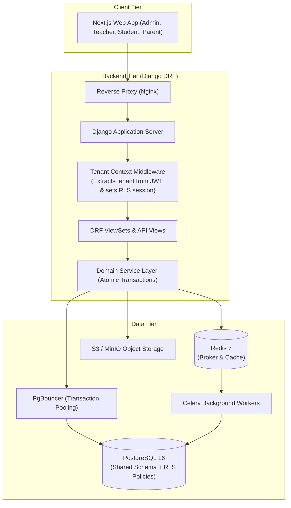
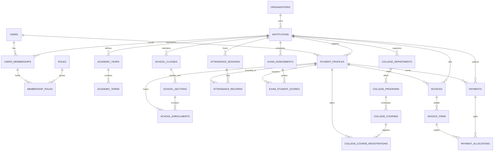

# EduNexus — Unified School & College ERP Platform
## Comprehensive Master Technical Plan & Implementation Blueprint (`planning.md`)

---

## 1. Project Overview & Architecture Analysis

### 1.1 Executive Summary
**EduNexus** is an enterprise-grade, multi-tenant SaaS Educational Resource Planning (ERP) platform designed to support both **K-12 schools** and **higher education colleges/universities** within a single unified codebase and database architecture.

Rather than forcing schools into higher education models (e.g. forcing 4th-grade elementary classes to have "Degree Programs" and "Credit Units") or degrading colleges to basic school classrooms (e.g. losing prerequisite graphs, semester course add/drop, backlogs, SGPA/CGPA), EduNexus employs a **Unified Core Engine** with **Specialized Structural Facades**:
- **Shared Core**: Multi-tenancy, Identity, Role-Based Access Control (RBAC), Student Information System (SIS) master identity, Attendance engine, Financial billing & Invoicing, Notifications, Audit logs.
- **School Facade**: Academic Year $\rightarrow$ Class (Grade) $\rightarrow$ Section (Division) $\rightarrow$ Fixed class subjects $\rightarrow$ Section-based cohort enrollment $\rightarrow$ Formative/Summative assessments $\rightarrow$ Annual year-end promotion workflow.
- **College Facade**: Academic Year $\rightarrow$ Department $\rightarrow$ Academic Program $\rightarrow$ Academic Regulation $\rightarrow$ Semester $\rightarrow$ Course Catalog (Lecture-Tutorial-Practical credits, prerequisites) $\rightarrow$ Individual student course registration $\rightarrow$ Continuous internal assessment + theory/practical exams $\rightarrow$ Grade points, SGPA/CGPA, supplementary exams.

### 1.2 Technology Stack
- **Backend**: Python 3.12, Django 5.x, Django REST Framework (DRF), `django-cors-headers`, `djangorestframework-simplejwt`, `psycopg` (v3).
- **Database**: PostgreSQL 16 with native Row-Level Security (RLS), custom `app.current_institution_id` session context, strict foreign keys, check constraints, composite B-tree/GIN indexes.
- **Frontend**: Next.js 14+ (JavaScript/JSX, React 18+), Tailwind CSS, Lucide React icons, Axios/Fetch API layer.
- **Cache & Async Processing**: Redis 7+, Celery for asynchronous jobs (notifications, report card generation, bulk invoices, late fee compounding).
- **Storage**: S3-compatible cloud object storage (AWS S3 or MinIO) for student documents, photos, marksheets, receipts.
- **Containerization**: Docker & Docker Compose for reproducible local and staging environments.

### 1.3 Engineering Philosophy & Developer Guidelines (AGENT.md Compliance)
All development and schema decisions strictly comply with [AGENT.md](file:///C:/Users/HP/.gemini/antigravity/scratch/edunexus/AGENT.md):
- **Simplicity & Maintainability**: Build straightforward, practical software. No unnecessary abstractions, no premature microservices, no excessive folder layers (no separate `helpers`/`utils`/`factories` unless clear necessity arises).
- **DBMS Learning Mode**: Every database table, relationship cardinality (1:1, 1:N, M:N), primary key, foreign key (`ON DELETE` behavior), check constraint, normalization level, and index will be explained in clear, educational language with practical SQL/Django examples prior to implementation.
- **Frontend Standards**: Pure JavaScript and JSX for Next.js and React; no TypeScript overhead. Clean functional components without unnecessary hooks or premature global state libraries.
- **Human-Written Code**: No fake or AI-sounding comments, no emojis in code or logs, clean early returns, and transparent verification reporting.


---

## 2. System Architecture & Tenancy Strategy

### 2.1 Multi-Tenant Isolation Architecture
EduNexus adopts a **Shared PostgreSQL Database with Shared Schema**, backed by **Dual-Gate Tenant Isolation**:
1. **Gate 1 — Application Layer (Django ORM)**: All tenant-owned models inherit from `TenantModel`. A custom manager (`TenantManager`) and QuerySet (`TenantQuerySet`) automatically inject `filter(institution=request.institution)`.
2. **Gate 2 — Database Layer (PostgreSQL Row-Level Security - RLS)**: Tables have PostgreSQL RLS enabled. A database connection hook/middleware issues:
   ```sql
   SET LOCAL app.current_institution_id = '<current_institution_uuid>';
   ```
   PostgreSQL kernel-level security guarantees that even if a developer forgets a filter or executes raw SQL, records from other tenants remain completely invisible and immutable.



### 2.2 Security & Authentication Workflow
- Global user account (`User` table) allows a single physical human to be a parent at School A, a professor at College B, and an administrator at Organization C.
- Login via `/api/v1/auth/login/` returns a scoped JWT containing active `institution_id` and cached role permissions.
- Multi-institution users can switch context via `/api/v1/auth/switch-institution/` without re-entering credentials.
- Passwords hashed using Argon2id (`django[argon2]`).
- Sensitive operations use `transaction.atomic()` with `select_for_update()` to prevent race conditions during course registration and fee allocations.

---

## 3. Database Schema & Data Dictionary

### 3.1 Entity Relationship Diagram (ERD)



### 3.2 Core Table Specifications

#### 1. Identity & Tenancy
- **`organizations`**: `id` (UUID PK), `name` (VARCHAR 255), `slug` (VARCHAR 100 UNIQUE), `billing_email` (VARCHAR 255), `created_at`, `updated_at`.
- **`institutions`**: `id` (UUID PK), `organization_id` (FK -> `organizations.id`), `name` (VARCHAR 255), `code` (VARCHAR 50), `institution_type` (VARCHAR 20 CHECK: `'SCHOOL'`, `'COLLEGE'`, `'HYBRID'`), `timezone` (VARCHAR 50), `currency_code` (VARCHAR 3), `settings` (JSONB), `is_active` (BOOL), `created_at`, `updated_at`.
- **`users`**: `id` (UUID PK), `email` (VARCHAR 255 UNIQUE), `phone_number` (VARCHAR 20 UNIQUE NULL), `password_hash` (VARCHAR 255), `first_name` (VARCHAR 100), `last_name` (VARCHAR 100), `is_platform_admin` (BOOL), `is_active` (BOOL), `created_at`, `updated_at`.
- **`institution_memberships`**: `id` (UUID PK), `institution_id` (FK -> `institutions.id`), `user_id` (FK -> `users.id`), `membership_type` (VARCHAR 30: `'STUDENT'`, `'FACULTY'`, `'STAFF'`, `'PARENT'`), `identification_number` (VARCHAR 100), `status` (VARCHAR 30), `created_at`.
- **`roles`**: `id` (UUID PK), `institution_id` (FK -> `institutions.id` NULL), `name` (VARCHAR 100), `code` (VARCHAR 50), `description` (TEXT).
- **`permissions`**: `id` (VARCHAR 100 PK), `category` (VARCHAR 50), `description` (TEXT).
- **`membership_roles`**: `id` (UUID PK), `membership_id` (FK), `role_id` (FK), `scope_type` (VARCHAR 50 NULL), `scope_id` (UUID NULL).

#### 2. Academic Core (Shared, School, College)
- **`academic_years`**: `id` (UUID PK), `institution_id` (FK), `name` (VARCHAR 50), `start_date` (DATE), `end_date` (DATE), `is_current` (BOOL).
  - *Constraints*: `CHECK(end_date > start_date)`, `UNIQUE(institution_id, name)`.
- **`academic_terms`**: `id` (UUID PK), `institution_id` (FK), `academic_year_id` (FK), `name` (VARCHAR 100), `start_date` (DATE), `end_date` (DATE), `is_active` (BOOL).
- **`school_classes`**: `id` (UUID PK), `institution_id` (FK), `name` (VARCHAR 50, e.g. `'Grade 10'`), `sequence_order` (SMALLINT).
- **`school_sections`**: `id` (UUID PK), `institution_id` (FK), `school_class_id` (FK), `name` (VARCHAR 20, e.g. `'A'`), `room_number` (VARCHAR 50), `class_teacher_id` (FK -> `institution_memberships.id` NULL).
- **`college_departments`**: `id` (UUID PK), `institution_id` (FK), `name` (VARCHAR 150), `code` (VARCHAR 20), `head_of_department_id` (FK NULL).
- **`college_programs`**: `id` (UUID PK), `institution_id` (FK), `department_id` (FK), `name` (VARCHAR 150), `code` (VARCHAR 30), `duration_semesters` (SMALLINT), `total_credits_required` (NUMERIC(5,2)).
- **`college_courses`**: `id` (UUID PK), `institution_id` (FK), `department_id` (FK), `course_code` (VARCHAR 30), `title` (VARCHAR 200), `lecture_credits` (SMALLINT), `tutorial_credits` (SMALLINT), `practical_credits` (SMALLINT), `total_credits` (NUMERIC(4,2)), `is_elective` (BOOL).

#### 3. Student Information System (SIS)
- **`student_profiles`**: `id` (UUID PK), `institution_id` (FK), `membership_id` (FK UNIQUE), `admission_number` (VARCHAR 100), `admission_date` (DATE), `date_of_birth` (DATE), `gender` (VARCHAR 20), `blood_group` (VARCHAR 5), `residential_address` (TEXT), `emergency_contact_name` (VARCHAR 150), `emergency_contact_phone` (VARCHAR 25), `current_status` (VARCHAR 30).
  - *Constraints*: `UNIQUE(institution_id, admission_number)`.
- **`school_enrollments`**: `id` (UUID PK), `institution_id` (FK), `student_id` (FK -> `student_profiles.id`), `academic_year_id` (FK), `section_id` (FK -> `school_sections.id`), `roll_number` (SMALLINT), `enrollment_status` (VARCHAR 30).
  - *Constraints*: `UNIQUE(academic_year_id, student_id)`, `UNIQUE(academic_year_id, section_id, roll_number)`.
- **`college_course_registrations`**: `id` (UUID PK), `institution_id` (FK), `student_id` (FK), `academic_term_id` (FK), `course_id` (FK), `registration_type` (VARCHAR 30), `registration_status` (VARCHAR 30).
  - *Constraints*: `UNIQUE(academic_term_id, student_id, course_id)`.

#### 4. Attendance Management
- **`attendance_sessions`**: `id` (UUID PK), `institution_id` (FK), `session_date` (DATE), `session_type` (VARCHAR 20: `'DAILY_HOMEROOM'`, `'PERIOD_WISE'`, `'LECTURE'`), `school_section_id` (FK NULL), `college_course_id` (FK NULL), `period_slot` (SMALLINT NULL), `taken_by_membership_id` (FK), `is_locked` (BOOL).
  - *Constraints*: `CHECK((school_section_id IS NOT NULL AND college_course_id IS NULL) OR (school_section_id IS NULL AND college_course_id IS NOT NULL))`, `UNIQUE(institution_id, session_date, school_section_id, period_slot)`.
- **`attendance_records`**: `id` (UUID PK), `institution_id` (FK), `session_id` (FK), `student_id` (FK), `status` (VARCHAR 20: `'PRESENT'`, `'ABSENT'`, `'LATE'`, `'EXCUSED'`), `remarks` (TEXT).
  - *Constraints*: `UNIQUE(session_id, student_id)`.
- **`attendance_audit_logs`**: `id` (UUID PK), `attendance_record_id` (FK), `previous_status` (VARCHAR 20), `new_status` (VARCHAR 20), `modified_by_id` (FK), `reason` (TEXT), `timestamp` (TIMESTAMPTZ).

#### 5. Examination & Grading
- **`exam_grading_scales`**: `id` (UUID PK), `institution_id` (FK), `name` (VARCHAR 100), `scale_type` (VARCHAR 30: `'PERCENTAGE_BASED'`, `'LETTER_GRADE_POINTS'`).
- **`grading_scale_tiers`**: `id` (UUID PK), `grading_scale_id` (FK), `letter_grade` (VARCHAR 5), `min_percentage` (NUMERIC(5,2)), `max_percentage` (NUMERIC(5,2)), `grade_point` (NUMERIC(4,2)), `is_passing_grade` (BOOL).
- **`exam_assessments`**: `id` (UUID PK), `institution_id` (FK), `academic_term_id` (FK), `name` (VARCHAR 150), `assessment_type` (VARCHAR 30), `max_marks` (NUMERIC(6,2)), `pass_marks` (NUMERIC(6,2)), `weightage_percentage` (NUMERIC(5,2)), `status` (VARCHAR 30: `'DRAFT'`, `'MARKS_ENTRY_OPEN'`, `'MODERATION'`, `'PUBLISHED'`, `'LOCKED'`).
- **`exam_student_scores`**: `id` (UUID PK), `institution_id` (FK), `assessment_id` (FK), `student_id` (FK), `marks_obtained` (NUMERIC(6,2) NULL), `is_absent` (BOOL), `grade_point_awarded` (NUMERIC(4,2) NULL), `letter_grade_awarded` (VARCHAR 5 NULL), `evaluator_membership_id` (FK).
  - *Constraints*: `CHECK(marks_obtained >= 0)`, `CHECK(marks_obtained <= max_marks)`, `UNIQUE(assessment_id, student_id)`.

#### 6. Fee & Finance Management
- **`fee_structures`**: `id` (UUID PK), `institution_id` (FK), `academic_year_id` (FK), `name` (VARCHAR 150), `target_type` (VARCHAR 30: `'SCHOOL_CLASS'`, `'COLLEGE_PROGRAM'`), `school_class_id` (FK NULL), `college_program_id` (FK NULL), `total_amount` (BIGINT in minor units).
- **`invoices`**: `id` (UUID PK), `institution_id` (FK), `student_id` (FK), `invoice_number` (VARCHAR 50), `issue_date` (DATE), `due_date` (DATE), `subtotal_amount` (BIGINT), `discount_amount` (BIGINT), `tax_amount` (BIGINT), `total_amount` (BIGINT), `paid_amount` (BIGINT DEFAULT 0), `status` (VARCHAR 30: `'UNPAID'`, `'PARTIALLY_PAID'`, `'PAID'`, `'OVERDUE'`, `'CANCELLED'`).
  - *Constraints*: `CHECK(due_date >= issue_date)`, `CHECK(paid_amount <= total_amount)`, `UNIQUE(institution_id, invoice_number)`.
- **`invoice_items`**: `id` (UUID PK), `invoice_id` (FK), `fee_category` (VARCHAR 50), `amount` (BIGINT), `allocated_amount` (BIGINT DEFAULT 0).
- **`payments`**: `id` (UUID PK), `institution_id` (FK), `student_id` (FK), `receipt_number` (VARCHAR 50), `payment_method` (VARCHAR 30), `amount` (BIGINT), `currency` (VARCHAR 3), `idempotency_key` (VARCHAR 255 UNIQUE), `gateway_transaction_id` (VARCHAR 255 NULL), `status` (VARCHAR 30: `'COMPLETED'`, `'FAILED'`, `'REFUNDED'`), `received_at` (TIMESTAMPTZ).
- **`payment_allocations`**: `id` (UUID PK), `payment_id` (FK), `invoice_item_id` (FK), `allocated_amount` (BIGINT), `created_at` (TIMESTAMPTZ).

---

## 4. API Endpoints Inventory

All endpoints reside under `/api/v1/` and return standardized JSON envelopes.

```json
{
  "success": true,
  "data": { ... },
  "error": null,
  "meta": { "request_id": "req_...", "timestamp": "2026-10-23T11:00:00Z" }
}
```

### 4.1 Authentication & Multi-Tenancy
| Method | Endpoint | Permission | Description |
| :--- | :--- | :--- | :--- |
| `POST` | `/api/v1/auth/login/` | AllowAny | Global user authentication. |
| `POST` | `/api/v1/auth/refresh/` | AllowAny | Refresh short-lived JWT access token. |
| `POST` | `/api/v1/auth/switch-institution/` | IsAuthenticated | Switch active institution context. |
| `POST` | `/api/v1/auth/logout/` | IsAuthenticated | Invalidate refresh token. |
| `GET` | `/api/v1/institutions/current/` | IsInstitutionMember | Get active institution profile & settings. |

### 4.2 Academic Setup & Structures
| Method | Endpoint | Permission | Description |
| :--- | :--- | :--- | :--- |
| `GET, POST` | `/api/v1/academics/years/` | `academics:years:manage` | List/create academic cycles. |
| `GET, POST` | `/api/v1/academics/terms/` | `academics:terms:manage` | List/create academic terms. |
| `GET, POST` | `/api/v1/academics/school/classes/` | `academics:structure:manage` | Manage school grades (1-12). |
| `GET, POST` | `/api/v1/academics/school/sections/` | `academics:structure:manage` | Manage sections per grade. |
| `GET, POST` | `/api/v1/academics/college/departments/` | `academics:structure:manage` | Manage college academic departments. |
| `GET, POST` | `/api/v1/academics/college/programs/` | `academics:structure:manage` | Manage degree programs. |
| `GET, POST` | `/api/v1/academics/college/courses/` | `academics:courses:manage` | Manage credit-based course catalog. |

### 4.3 Student Information System (SIS)
| Method | Endpoint | Permission | Description |
| :--- | :--- | :--- | :--- |
| `GET, POST` | `/api/v1/students/` | `students:view/create` | List & filter student directory. |
| `GET, PUT` | `/api/v1/students/{id}/` | `students:view/edit` | Retrieve full student profile. |
| `POST` | `/api/v1/students/school/enroll/` | `academics:enroll:manage`| Enroll student in school section. |
| `POST` | `/api/v1/students/school/promote/` | `academics:enroll:promote`| Batch annual promotion of section. |
| `POST` | `/api/v1/students/college/register-courses/` | `academics:courses:register`| Student semester course registration. |

### 4.4 Attendance Management
| Method | Endpoint | Permission | Description |
| :--- | :--- | :--- | :--- |
| `POST` | `/api/v1/attendance/sessions/` | `attendance:mark` | Submit daily or lecture roll call. |
| `GET` | `/api/v1/attendance/sessions/{id}/` | `attendance:view` | View submitted roll call details. |
| `POST` | `/api/v1/attendance/corrections/` | `attendance:correct` | Request post-lock attendance correction. |
| `GET` | `/api/v1/attendance/students/{id}/summary/` | `attendance:view` | Monthly and term attendance percentage. |

### 4.5 Examinations & Grading
| Method | Endpoint | Permission | Description |
| :--- | :--- | :--- | :--- |
| `GET, POST` | `/api/v1/examinations/assessments/` | `exams:manage` | Create exams, define max/pass marks. |
| `POST` | `/api/v1/examinations/assessments/{id}/scores/` | `exams:marks:enter` | Batch marks entry for students. |
| `POST` | `/api/v1/examinations/assessments/{id}/publish/` | `exams:publish` | Validate, lock, and publish results. |
| `GET` | `/api/v1/examinations/students/{id}/transcript/` | `exams:view` | College SGPA/CGPA transcript or School report card. |

### 4.6 Fees & Invoicing
| Method | Endpoint | Permission | Description |
| :--- | :--- | :--- | :--- |
| `GET, POST` | `/api/v1/finance/fee-structures/` | `finance:fees:manage` | Manage fee templates per grade/program. |
| `POST` | `/api/v1/finance/invoices/generate-batch/` | `finance:invoices:create`| Batch generate invoices for class/program. |
| `GET` | `/api/v1/finance/invoices/` | `finance:invoices:view` | Filter invoices by status, student, grade. |
| `POST` | `/api/v1/finance/payments/` | `finance:payments:collect`| Record manual/cash payment with allocations. |
| `POST` | `/api/v1/finance/payments/webhook/` | AllowAny (HMAC) | Payment gateway callback (Stripe/Razorpay). |

---

## 5. Directory & Folder Structure

```
edunexus/
├── planning.md                   # This master blueprint file
├── docker-compose.yml            # Multi-container orchestration (DB, Web, API, Redis)
├── docker/
│   ├── backend/
│   │   ├── Dockerfile
│   │   └── entrypoint.sh
│   ├── frontend/
│   │   └── Dockerfile
│   └── nginx/
│       └── default.conf
├── backend/
│   ├── manage.py
│   ├── requirements.txt          # Python dependencies
│   ├── config/                   # Project root
│   │   ├── __init__.py
│   │   ├── settings.py           # Base settings with env toggles
│   │   ├── urls.py               # Master API routing
│   │   ├── wsgi.py
│   │   └── asgi.py
│   ├── common/                   # Shared architectural core
│   │   ├── __init__.py
│   │   ├── models.py             # UUIDModel, TimeStampedModel, TenantModel
│   │   ├── managers.py           # TenantManager, TenantQuerySet
│   │   ├── middleware.py         # TenantSecurityMiddleware (RLS context)
│   │   ├── permissions.py        # HasPermission, IsInstitutionMember
│   │   ├── pagination.py         # StandardResultsPagination
│   │   └── exceptions.py         # Global error handler
│   ├── apps/
│   │   ├── authentication/       # JWT & session handling
│   │   ├── organizations/        # Trusts & parent bodies
│   │   ├── institutions/         # Tenant profiles, settings, branding
│   │   ├── users/                # Global users & memberships
│   │   ├── permissions/          # Dynamic RBAC engine
│   │   ├── academics/            # Shared core + school/college facades
│   │   ├── students/             # SIS, profiles, parent linkages
│   │   ├── attendance/           # Daily & lecture roll call, locks, audit
│   │   ├── examinations/         # Assessments, grading scales, marks, SGPA/CGPA
│   │   ├── fees/                 # Fee structures, invoicing engine
│   │   └── payments/             # Multi-line allocation & receipting
│   └── tests/                    # Enterprise test suite
│       ├── unit/
│       ├── integration/
│       ├── tenant_isolation/     # Cross-tenant data leakage tests
│       └── concurrency/          # select_for_update race tests
└── frontend/
    ├── package.json
    ├── next.config.js
    ├── tailwind.config.js
    ├── public/
    └── src/
        ├── components/           # UI library (Button, Modal, Table, Badge, Card)
        ├── layouts/              # Role-specific layouts (AdminLayout, FacultyLayout, StudentLayout)
        ├── contexts/             # AuthContext, TenantContext
        ├── hooks/                # useAuth, useTenant, usePermissions
        ├── pages/                # Next.js JSX routes
        └── services/             # Axios API client modules
```

---

## 6. Development Phases & Roadmap

| Phase | Title | Primary Deliverable |
| :--- | :--- | :--- |
| **Phase 0** | **Discovery & Planning** | Comprehensive architecture, ERD, data dictionary, `planning.md`. *(Completed)* |
| **Phase 1** | **Foundation & Scaffold** | Docker environment, PostgreSQL 16, Django 5 + DRF, Common Base Models, Tenant Middleware, Test Suite. |
| **Phase 2** | **Identity, Tenancy & RBAC** | Organizations, Institutions, Users, Memberships, Dynamic RBAC, JWT Auth with Institution switching. |
| **Phase 3** | **Academic Core & SIS** | School Classes & Sections, College Depts, Programs & Courses, Student Profile Lifecycle, Enrollment Engine. |
| **Phase 4** | **Attendance & Audit** | Daily & Lecture roll call, Locks, Audit Logs, Absentee Summaries. |
| **Phase 5** | **Examinations & Grading** | Grading Scales, Assessment Creation, Batch Marks Entry, Moderation, SGPA/CGPA Calculations, Result Publishing. |
| **Phase 6** | **Fees & Payments** | Fee Structure Configuration, Invoicing Engine, Payment Recording, Multi-line Allocations, Receipt Generation. |
| **Phase 7** | **Supporting Modules** | Timetable, Library, Transport, Notifications. |
| **Phase 8** | **Frontend Dashboards** | Next.js role-based dashboards (Admin, Faculty, Student/Parent) with Tailwind CSS. |
| **Phase 9** | **Hardening & Production** | RLS validation, load testing, security audit, deployment automation. |

---

## 7. Step-by-Step Implementation Checklist

Use this checklist during execution. Check off each box (`[x]`) upon successful completion and test verification.

### Phase 1: Foundation & Scaffold Setup
- [x] 1.1 Configure local repository structure and `.gitignore`.
- [x] 1.2 Create `docker-compose.yml` with PostgreSQL 16 (configured with UUID extensions), Redis 7, and Python 3.12 containers.
- [x] 1.3 Initialize Django project (`config`) with environment-based settings (`django-environ` / `python-dotenv`).
- [x] 1.4 Implement `common/models.py` with `UUIDModel`, `TimeStampedModel`, `TenantModel`.
- [x] 1.5 Implement `common/managers.py` with `TenantQuerySet` and `TenantManager`.
- [x] 1.6 Implement `common/middleware.py` with `TenantSecurityMiddleware` setting Postgres `app.current_institution_id`.
- [x] 1.7 Implement centralized DRF exception handler in `common/exceptions.py`.
- [x] 1.8 Setup `pytest` test runner with PostgreSQL test database configuration.

### Phase 2: Identity, Tenancy & RBAC
- [x] 2.1 Create `organizations` app and models (`Organization`).
- [x] 2.2 Create `institutions` app and models (`Institution` with `institution_type`, `timezone`, `settings`).
- [x] 2.3 Create `users` app with custom `User` model using Argon2id password hashing.
- [x] 2.4 Create `InstitutionMembership` model binding global users to institutions.
- [x] 2.5 Create `permissions` app with `Role`, `Permission`, `RolePermission`, and `MembershipRole` (with structural scoping).
- [x] 2.6 Implement JWT authentication endpoints: `/api/v1/auth/login/`, `/api/v1/auth/refresh/`, `/api/v1/auth/switch-institution/`.
- [x] 2.7 Write automated tests verifying multi-tenant isolation and tenant switching.

### Phase 3: Academic Core & Student Information System (SIS)
- [x] 3.1 Implement shared academic models: `AcademicYear`, `AcademicTerm`.
- [x] 3.2 Implement School structural models: `SchoolClass`, `SchoolSection`.
- [x] 3.3 Implement College structural models: `CollegeDepartment`, `CollegeProgram`, `CollegeCourse` (with L-T-P credits).
- [x] 3.4 Implement SIS master model: `StudentProfile` (with admission number unique per institution).
- [x] 3.5 Implement School cohort enrollment model: `SchoolEnrollment` with unique roll numbers per section.
- [x] 3.6 Implement College credit registration model: `CollegeCourseRegistration`.
- [x] 3.7 Build School & College REST ViewSets and API routing.
- [x] 3.8 Write unit and integration tests for enrollments, registrations, and database constraints.

### Phase 4: Attendance Management
- [x] 4.1 Implement `AttendanceSession` model supporting both daily homeroom and lecture-wise slots.
- [x] 4.2 Implement `AttendanceRecord` model with status enums (`PRESENT`, `ABSENT`, `LATE`, `EXCUSED`).
- [x] 4.3 Add database unique constraints preventing duplicate roll calls for the same section/slot.
- [x] 4.4 Implement `AttendanceAuditLog` model recording all post-lock edits with mandatory reason strings.
- [x] 4.5 Build attendance submission API (`/api/v1/attendance/sessions/`) and correction workflow.
- [x] 4.6 Write unit and integration tests for roll calls, locking, and audit-logged corrections.

### Phase 5: Examinations & Grading Engine
- [x] 5.1 Implement `ExamGradingScale` and `GradingScaleTier` models (letter grades, percentage ranges, grade points).
- [x] 5.2 Implement `ExamAssessment` model with status lifecycle (`DRAFT` $\rightarrow$ `MARKS_ENTRY` $\rightarrow$ `MODERATION` $\rightarrow$ `PUBLISHED`).
- [x] 5.3 Implement `ExamStudentScore` with database validation (`marks_obtained <= max_marks`).
- [x] 5.4 Build grading tier evaluation service mapping marks to letter grades and grade points.
- [x] 5.5 Implement atomic result publication service that locks scores from post-publication modification.
- [x] 5.6 Write unit and integration tests validating marks boundaries, absent handling, and publication locks.

### Phase 6: Fees & Finance Management
- [x] 6.1 Implement `FeeStructure` model mapping fee lines to school classes or college programs.
- [x] 6.2 Implement `Invoice` and `InvoiceItem` models storing monetary values in `BIGINT` minor units.
- [x] 6.3 Implement `Payment` model with mandatory `idempotency_key` and receipt number generation.
- [x] 6.4 Implement `PaymentAllocation` model supporting multi-line item settlement.
- [x] 6.5 Build `PaymentService` executing atomic invoice balancing using `select_for_update()`.
- [x] 6.6 Write unit and integration tests for multi-line allocations, idempotency retries, and balance enforcement.

### Phase 7: Supporting Modules (Timetable, Library, Transport, Notifications)
- [x] 7.1 Implement `timetable` app: time slots, classroom allocation, faculty schedule conflict detection.
- [x] 7.2 Implement `library` app: book master, copy accession numbers, issue/return ledger, overdue fine calculation.
- [x] 7.3 Implement `transport` app: vehicles, routes, pick-up stops, student route assignments.
- [x] 7.4 Implement `notifications` app: announcements and communication queues.

### Phase 8: Next.js Frontend Development
- [x] 8.1 Initialize Next.js project with Tailwind CSS, JSX, and Axios API client.
- [x] 8.2 Build authentication state management (`AuthContext`, `TenantContext`) with auto-refresh tokens.
- [x] 8.3 Implement Institution switcher component in the top navigation bar.
- [x] 8.4 Build Admin Dashboard: Student admissions, Academic structure, Staff directory.
- [x] 8.5 Build Teacher / Faculty Portal: Attendance roll call grid, Marks entry spreadsheet.
- [x] 8.6 Build Student / Parent Portal: Fee due alerts, Online payment checkout, Transcripts/Report cards, Attendance tracker.
- [x] 8.7 Implement responsive UI tested across desktop, tablet, and mobile views.

### Phase 9: Hardening, Security Review & Production Readiness
- [x] 9.1 Enable PostgreSQL Row-Level Security (RLS) on all tenant-owned tables and verify with cross-tenant penetration tests.
- [x] 9.2 Audit all API endpoints for missing permission decorators or exposed sensitive data.
- [x] 9.3 Perform database query optimization: inspect `EXPLAIN ANALYZE` on attendance, invoice, and marks queries.
- [x] 9.4 Configure automated daily database backups (`pg_dump` with WAL archiving to S3).
- [x] 9.5 Perform end-to-end user journey tests for both School and College workflows.
